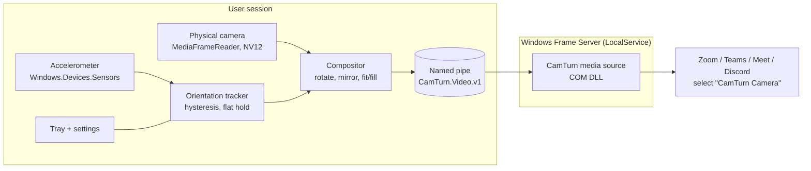

# CamTurn

**Keeps your webcam picture upright on Windows 11 2-in-1 laptops.** When you fold a convertible into tent, stand
or tablet mode, Windows rotates the screen, but the camera is fixed to the lid. Zoom, Teams, Discord and browsers
then show you sideways or upside down. CamTurn runs in the notification area, reads the device's accelerometer,
rotates the camera picture to match, and offers it to every app as a camera called **CamTurn Camera**. It works
offline, needs no account, and turns your real camera on only while an app is using it.

> **Status: pre-release (0.1.0).** Every part is built, but it has not yet been run end to end on real hardware.
> See [What has been tested](#what-has-been-tested) and [docs/KNOWN_ISSUES.md](docs/KNOWN_ISSUES.md).

<!-- Screenshots / demo GIF go here once captured on hardware:

-->

## Who it's for

People with a Windows 11 convertible (360° hinge or detachable) who join video calls in tent, stand or tablet mode,
for example the Dell Inspiron 16 7640 2-in-1 it was developed on.

## Requirements

- Windows 11, build 22000 or newer, 64-bit. **Windows 10 is not supported**: it lacks the built-in virtual camera
  API CamTurn relies on (see [FAQ](#faq) and [docs/ROADMAP.md](docs/ROADMAP.md)).
- A built-in or USB camera.
- An accelerometer for automatic rotation. Without one, CamTurn still works with a manually chosen rotation.
- Administrator rights once, to install.

## Install

1. Download `CamTurn-Setup-x.y.z.exe` from the [Releases](https://github.com/adikatre/camturn/releases) page.
   Optionally check it against the `.sha256` file next to it.
2. Run it. Windows asks for administrator permission once, because the installer registers the virtual camera
   for all users.
3. The installer isn't code-signed yet, so Windows SmartScreen may say "Windows protected your PC". Choose
   **More info → Run anyway** only if you downloaded it from this repository's Releases page.

## Quick start

1. After installing, CamTurn opens a short setup wizard. It checks your Windows version and the virtual camera,
   lets you pick your camera, and runs a rotation test.
2. In your video app, pick **CamTurn Camera** as the camera. Windows may list it as "CamTurn Camera Windows
   Virtual Camera".
   - Zoom: Settings → Video → Camera
   - Microsoft Teams: Settings → Devices → Camera
   - Discord: User Settings → Voice & Video → Camera
   - Google Meet (Chrome/Edge): the camera menu in the call
   - Windows Camera app: the switch-camera button
3. Fold your laptop. The picture stays upright.

If the picture turns the wrong way when you rotate the device, open **Settings → Orientation mapping → Flip
direction**.

## Supported apps

Only apps that have actually been tested are marked as working. Nothing has been verified on hardware yet
(manual test plan: [docs/TESTING.md](docs/TESTING.md)).

| App | Status |
|---|---|
| Windows Camera | Not yet tested |
| Microsoft Teams | Not yet tested |
| Zoom | Not yet tested |
| Google Meet (Chrome, Edge) | Not yet tested |
| Discord | Not yet tested |

## How it works

- **Two parts.** A small C++ media source runs inside Windows' camera service (Frame Server). It only serves
  frames. The tray app does the rest: reads the sensor, captures the real camera, rotates frames, and passes them
  to the media source over a named pipe.
- **Raw sensor, not screen rotation.** CamTurn follows the accelerometer itself, so it stays correct when Windows'
  rotation lock is on or the desktop is rotated manually. An advanced option follows the display rotation instead.
- **Camera on only when needed.** When an app opens CamTurn Camera, the media source connects. CamTurn then opens
  the physical camera, and closes it again 3 seconds after the last app stops. CamTurn also releases the camera
  when the PC is locked or goes to sleep.
- **Fixed output size.** Apps get 1280×720 or 1920×1080 at 30 fps. Portrait orientations are letterboxed (or
  cropped, if you prefer), because a camera's picture size can't change mid-call.

Design notes are in [docs/DECISIONS.md](docs/DECISIONS.md).

## FAQ

**Why Windows 11 only?** CamTurn uses `MFCreateVirtualCamera`, the virtual camera API that was added in Windows 11.
It needs no kernel driver and no third-party software, and gives the camera its own name. Windows 10 would need a
different approach (a DirectShow virtual camera); that is on the [roadmap](docs/ROADMAP.md).

**Why a separate camera instead of fixing the real one?** Apps read the physical camera directly, and Windows
offers no supported way to change its picture for all apps. A virtual camera that every app can choose is the
supported way to do it.

**Why not a Windows service?** The sensor and your camera's privacy settings belong to your user session. A
per-user tray app never needs to run with elevated rights. The only privileged step is the one-time install.

**Do I need OBS or other streaming software?** No. CamTurn does not need it and does not use it.

**Does CamTurn send anything over the network?** No. See [Privacy](#privacy).

## Limitations

- Windows 11 only. On convertibles without an accelerometer, only manual rotation is available.
- Portrait orientations show black bars (or a cropped picture), because the output size is fixed.
- Only one Windows user at a time can feed CamTurn Camera (fast user switching shares a single frame pipe).
- Some apps cache their camera list. Restart the app if CamTurn Camera doesn't appear.
- Unsigned installer: SmartScreen warns until code signing is set up.

## Privacy

CamTurn makes no network connections and collects no telemetry. Video frames stay in memory, pass only from CamTurn
to the Windows camera service on the same PC, and are never stored or sent anywhere. Settings
(`%APPDATA%\CamTurn\config.json`) and a small log (`%LOCALAPPDATA%\CamTurn\logs`) stay on your PC. The log and
**Copy diagnostics** remove your user name and profile path.

## Troubleshooting

| Problem | Try |
|---|---|
| CamTurn Camera isn't listed in an app | Restart the app. In CamTurn settings, check **Status → Virtual camera**; if it says "Not registered", click **Register virtual camera**. |
| Picture shows "Waiting for CamTurn" | CamTurn isn't running, or the camera couldn't open. Start CamTurn from the Start menu and check the status panel. |
| "Camera busy or blocked" | Close other apps that use the real camera directly. Check **Settings → Privacy & security → Camera → Let desktop apps access your camera**. |
| Picture rotates the wrong way | **Settings → Orientation mapping → Flip direction**. |
| Picture flips while the laptop lies flat | It shouldn't: CamTurn holds the last orientation when the device is flat. Please report it with diagnostics. |
| Anything else | Run `CamTurn.exe --diagnose` (or click **Copy diagnostics**) and attach the output to a [bug report](https://github.com/adikatre/camturn/issues/new?template=bug_report.yml). |

## Uninstall

**Settings → Apps → Installed apps → CamTurn → Uninstall.** This removes the program, the CamTurn Camera
device, the media source registration, your autostart entry, and your settings and logs. If Windows was still
using the media source, its DLL is deleted at the next restart.

## What has been tested

- **Automated, on every change (Linux CI):** about 150 unit and end-to-end tests. They cover the rotation math,
  orientation hysteresis, compositor, camera on/off logic, settings, and the frame protocol. Tests also run the
  whole app pipeline over a real named pipe, driven by a simulator of the Inspiron 16 7640 2-in-1 (`camturn-sim`,
  [docs/SIMULATOR.md](docs/SIMULATOR.md)). The C++ protocol and placeholder code are tested too.
- **Windows CI (set up; first run pending until the repository is on GitHub):** builds the C++ media source with
  MSVC and the WPF app, runs the Windows integration tests, and builds the installer. An experimental job installs
  and uninstalls on Windows Server 2025.
- **Not yet done:** running on the developer's laptop with real apps. See [docs/TESTING.md](docs/TESTING.md).

## Contributing

See [CONTRIBUTING.md](CONTRIBUTING.md), [docs/DEVELOPMENT.md](docs/DEVELOPMENT.md) and the
[Code of Conduct](CODE_OF_CONDUCT.md). To report a security issue, see [SECURITY.md](SECURITY.md).

## License

[MIT](LICENSE) © 2026 Aditya Katre. Third-party components: [THIRD_PARTY_NOTICES.md](THIRD_PARTY_NOTICES.md).
