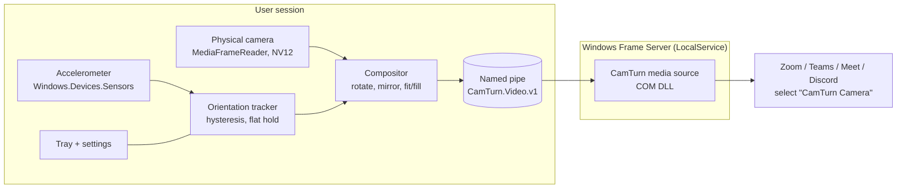

# CamTurn

**This is a test of Software-on-Demand: Initially created by Opus 5.5 via Claude Code, now being maintained using GPT 6.2 Astra & GPT 6.2 Sol.**

**Keeps your webcam picture upright on Windows 11 2-in-1 laptops.** When you fold a convertible into tent, stand
or tablet mode, Windows rotates the screen, but the camera is fixed to the lid. Zoom, Teams, Discord and browsers
then show you sideways or upside down. CamTurn runs in the notification area, reads the device's accelerometer,
rotates the camera picture to match, and offers it to every app as a camera called **CamTurn Camera**. It works
offline, needs no account, and turns your real camera on only while an app is using it.

> **Status: pre-release (0.1.0).** The earlier installer build exercised the virtual camera end to end on Windows CI. The portable package still needs verification. It has not yet been tested with
> a real webcam, accelerometer or video-call apps. See [What has been tested](#what-has-been-tested) and
> [docs/KNOWN_ISSUES.md](docs/KNOWN_ISSUES.md).

<!-- Screenshots / demo GIF go here once captured on hardware:

-->

## Who it's for

People with a Windows 11 convertible (360° hinge or detachable) who join video calls in tent, stand or tablet mode,
for example the Dell Inspiron 16 7640 2-in-1 it was developed on.

## Requirements

- Windows 11, build 22000 or newer, 64-bit. **Windows 10 is not supported**: it lacks the built-in virtual camera
  API CamTurn relies on (see [FAQ](#faq) and [docs/ROADMAP.md](docs/ROADMAP.md)).
- A built-in or USB camera.
- An accelerometer for automatic rotation. Without one, CamTurn still works with a manually chosen rotation.
- Administrator approval to enable the virtual camera on each PC. The tray app and local preview run as a normal user.

## Portable app

Keep `CamTurn.exe` in a folder of your choice. The Windows x64 build includes the .NET runtime. The release workflow
packages the EXE and its SHA-256 checksum. Older releases named `CamTurn-Setup-*.exe` are installers.

Double-click the EXE to start CamTurn in the notification area. Look under **Show hidden icons** if needed.
Double-click the tray icon or choose **Open settings** from its menu. The first time, this opens a short setup
wizard. Minimizing hides the window and stops its preview. Double-click the icon again to restore it.
Choose **Quit CamTurn** from the tray menu to exit. Starting with Windows is opt-in. If you move the EXE after
enabling that option, turn it off and back on in Settings to update the path.

## Quick start

1. In the wizard, choose **Create "CamTurn Camera"** when you want video apps to see it. Windows asks for
   administrator approval to put the camera component in `%ProgramFiles%\CamTurn Camera` and register it on
   that PC. You can skip this step for local preview and enable it later under **Settings → Register virtual camera**.
2. In your video app, pick **CamTurn Camera** as the camera. Windows may list it as "CamTurn Camera Windows
   Virtual Camera".
   - Zoom: Settings → Video → Camera
   - Microsoft Teams: Settings → Devices → Camera
   - Discord: User Settings → Voice & Video → Camera
   - Google Meet (Chrome/Edge): the camera menu in the call
   - Windows Camera app: the switch-camera button
3. Fold your laptop. The picture stays upright.

If the picture turns the wrong way when you rotate the device, open **Settings → Orientation mapping → Flip
direction**.

## Supported apps

Only apps that have actually been tested are marked as working. Nothing has been verified on hardware yet
(manual test plan: [docs/TESTING.md](docs/TESTING.md)).

| App | Status |
|---|---|
| Windows Camera | Not yet tested |
| Microsoft Teams | Not yet tested |
| Zoom | Not yet tested |
| Google Meet (Chrome, Edge) | Not yet tested |
| Discord | Not yet tested |

## How it works

- **Two parts.** A small C++ media source runs inside Windows' camera service (Frame Server). It only serves
  frames. The tray app does the rest: reads the sensor, captures the real camera, rotates frames, and passes them
  to the media source over a named pipe.
- **Raw sensor, not screen rotation.** CamTurn follows the accelerometer itself, so it stays correct when Windows'
  rotation lock is on or the desktop is rotated manually. An advanced option follows the display rotation instead.
- **Camera on only when needed.** When an app opens CamTurn Camera, the media source connects. CamTurn then opens
  the physical camera, and closes it again 3 seconds after the last app stops. CamTurn also releases the camera
  when the PC is locked or goes to sleep.
- **Fixed output size.** Apps get 1280×720 or 1920×1080 at 30 fps. Portrait orientations are letterboxed (or
  cropped, if you prefer), because a camera's picture size can't change mid-call.

Design notes are in [docs/DECISIONS.md](docs/DECISIONS.md).

## FAQ

**Why Windows 11 only?** CamTurn uses `MFCreateVirtualCamera`, the virtual camera API that was added in Windows 11.
It needs no kernel driver and no third-party software, and gives the camera its own name. Windows 10 would need a
different approach (a DirectShow virtual camera); that is on the [roadmap](docs/ROADMAP.md).

**Why a separate camera instead of fixing the real one?** Apps read the physical camera directly, and Windows
offers no supported way to change its picture for all apps. A virtual camera that every app can choose is the
supported way to do it.

**Why not a Windows service?** The sensor and your camera's privacy settings belong to your user session. A
per-user tray app never needs to run with elevated rights. Windows asks for administrator access when you register or remove the camera component.

**Do I need OBS or other streaming software?** No. CamTurn does not need it and does not use it.

**Does CamTurn send anything over the network?** No. See [Privacy](#privacy).

## Limitations

- Windows 11 only. On convertibles without an accelerometer, only manual rotation is available.
- Portrait orientations show black bars (or a cropped picture), because the output size is fixed.
- Only one Windows user at a time can feed CamTurn Camera (fast user switching shares a single frame pipe).
- Some apps cache their camera list. Restart the app if CamTurn Camera doesn't appear.
- The portable executable is unsigned. Windows SmartScreen may show a warning.

## Privacy

CamTurn makes no network connections and collects no telemetry. Video frames stay in memory, pass only from CamTurn
to the Windows camera service on the same PC, and are never stored or sent anywhere. Settings
(`%APPDATA%\CamTurn\config.json`) and a small log (`%LOCALAPPDATA%\CamTurn\logs`) stay on your PC. The log and
**Copy diagnostics** remove your user name and profile path.

## Troubleshooting

| Problem | Try |
|---|---|
| CamTurn Camera isn't listed in an app | Restart the app. In CamTurn settings, check **Status → Virtual camera**; if it says "Not registered", click **Register virtual camera**. |
| Picture shows "Waiting for CamTurn" | CamTurn isn't running, or the camera couldn't open. Open the portable CamTurn.exe and check the status panel. |
| "Camera busy or blocked" | Close other apps that use the real camera directly. Check **Settings → Privacy & security → Camera → Let desktop apps access your camera**. |
| Picture rotates the wrong way | **Settings → Orientation mapping → Flip direction**. |
| Picture flips while the laptop lies flat | It shouldn't: CamTurn holds the last orientation when the device is flat. Please report it with diagnostics. |
| Anything else | Run `CamTurn.exe --diagnose` (or click **Copy diagnostics**) and attach the output to a [bug report](https://github.com/adikatre/camturn/issues/new?template=bug_report.yml). |

## Remove CamTurn

If you enabled **Start with Windows**, turn it off in CamTurn settings. Choose **Quit CamTurn** in the tray and
delete the portable EXE. If you enabled the virtual camera, remove **CamTurn Camera** under
**Windows Settings → Apps → Installed apps**. You can also remove the component with `CamTurn.exe --unregister`
before deleting the EXE. Close apps using the camera first.

Preferences and logs are per PC. To clear them, delete `%APPDATA%\CamTurn` and `%LOCALAPPDATA%\CamTurn`.
The bundled runtime also uses a per-user extraction cache, normally under `%TEMP%\.net\CamTurn`.

## What has been tested

- **Automated, on every change (Linux CI):** about 150 unit and end-to-end tests. They cover the rotation math,
  orientation hysteresis, compositor, camera on/off logic, settings, and the frame protocol. Tests also run the
  whole app pipeline over a real named pipe, driven by a simulator of the Inspiron 16 7640 2-in-1 (`camturn-sim`,
  [docs/SIMULATOR.md](docs/SIMULATOR.md)). The C++ protocol and placeholder code are tested too.
- **Portable Windows workflow:** configured to build the single EXE, launch an isolated copy on a CI runner,
  then check camera registration, placeholder and test-pattern delivery, and component removal on Windows Server
  2025. These checks have not been run against this revision.
- **Not yet done:** the real webcam and accelerometer, the settings UI, and Zoom, Teams, Meet and Discord on the
  developer's laptop. See [docs/TESTING.md](docs/TESTING.md).

## Contributing

See [CONTRIBUTING.md](CONTRIBUTING.md), [docs/DEVELOPMENT.md](docs/DEVELOPMENT.md) and the
[Code of Conduct](CODE_OF_CONDUCT.md). To report a security issue, see [SECURITY.md](SECURITY.md).

## License

[MIT](LICENSE) © 2026 Aditya Katre. Third-party components: [THIRD_PARTY_NOTICES.md](THIRD_PARTY_NOTICES.md).
